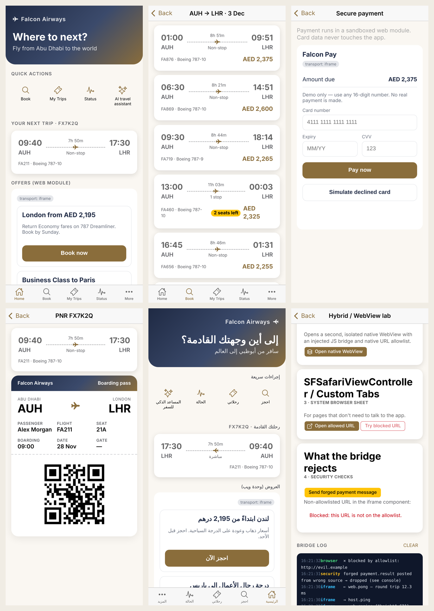

# Falcon Airways — Hybrid Ionic-Angular app

     

**▶ Live demo:** https://YOUR-GITHUB-USERNAME.github.io/falcon-airways-ionic-angular/ — best viewed on a phone, or in Chrome DevTools mobile view.

A portfolio app for a **fictional airline** (hub: Abu Dhabi), built to demonstrate hybrid mobile engineering
with **Ionic 9 + Angular 22 + Capacitor 8**. The focus is on running web content inside a mobile app the right way:
**WebView / WKWebView, JS bridges, and their security**.

<p align="center">
  
</p>

> Falcon Airways is an invented brand. All flights, fares and policies are mock data.



## Features

| Area | What it does | Hybrid / engineering skill shown |
| --- | --- | --- |
| **Home** | Hero, quick actions, next trip, offers | Offers is a **hosted web module in a sandboxed iframe** that can ask the app to navigate to allowlisted routes only |
| **Book** | Search → results → passengers → payment | Reactive forms + validators, lazy routes, route guards, signal store, skeleton loading, pull-to-refresh |
| **Payment** | Hosted payment page | **Payment runs in a WebView** (PCI scope stays out of the app); app receives only a validated `{status, reference}` |
| **Check-in** | Seat map → boarding pass | Web journey embedded in an iframe **or** opened in a **native WebView** through a custom Capacitor plugin, with the same page and bridge in both |
| **My Trips** | Saved bookings + QR boarding pass | **Offline-first** (Capacitor Preferences), QR generated on device |
| **Flight status** | Live status | RxJS polling with `switchMap` cancellation and `shareReplay` |
| **AI assistant** | Baggage / check-in / status chat with action chips | Assistant behind an `AssistantProvider` interface: on-device rule engine now, swappable for an LLM backend |
| **Hybrid lab** | Interactive WebView showcase + live bridge log | iframe bridge with ping/latency, native WebView plugin, system browser, blocked URL and forged-message demos |
| **Settings** | English / **Arabic (RTL)**, dark mode | Full RTL mirroring (logical CSS properties), persisted preferences |

## Architecture

```
src/app/
├── core/                         # singletons — no UI
│   ├── api/                      # HTTP services (flight, booking)
│   ├── interceptors/             # headers + correlation id, mock backend
│   ├── hybrid/                   # ★ WebView layer
│   │   ├── bridge-protocol.ts    #   versioned message contract + runtime validation
│   │   ├── url-policy.ts         #   URL allowlist / origin rules (shared by every container)
│   │   ├── web-module-launcher…  #   native WebView sessions as an Observable
│   │   ├── in-app-browser…       #   SFSafariViewController / Custom Tabs
│   │   └── native-webview/       #   custom Capacitor plugin: TS API + web fallback
│   ├── state/                    # signal stores (booking funnel, trips)
│   ├── i18n/  settings/          # EN/AR dictionaries, RTL, theme
│   ├── ai/                       # assistant provider interface + rule engine
│   ├── storage/  platform/       # Preferences wrapper, network status
│   └── models/  data/
├── shared/                       # reusable UI: secure-webview, flight-card, pipes, icons
└── features/                     # one folder per feature, all lazy loaded
    ├── home/ flights/ booking/ trips/ check-in/ flight-status/
    ├── assistant/ hybrid-lab/ settings/ more/ tabs/

public/web/                       # ★ hosted web modules (would live on their own domain)
├── falcon-bridge.js              #   web-side SDK: auto-detects iframe / WKWebView / Android WebView
├── payment.html/.js  check-in.html/.js  offers.html/.js

native/                           # ★ native plugin sources
├── android/NativeWebViewPlugin.kt
└── ios/NativeWebViewPlugin.swift
```

**Rules:** features depend on `core` and `shared`, never on each other. Pages hold no HTTP logic. State lives
in signal stores. Every feature is a lazy chunk (see the build output).

## The WebView bridge

One web page runs in three containers. `falcon-bridge.js` picks the transport at runtime:

| Container | Web → app | App → web |
| --- | --- | --- |
| `<iframe>` (in the Ionic WebView) | `parent.postMessage(env, hostOrigin)` | `iframe.contentWindow.postMessage(env, frameOrigin)` |
| iOS **WKWebView** (plugin) | `webkit.messageHandlers.falconBridge.postMessage(json)` | `evaluateJavaScript("FalconBridge.receive(…)")` |
| Android **WebView** (plugin) | `FalconBridgeAndroid.postMessage(json)` via `addWebMessageListener` | `evaluateJavascript("FalconBridge.receive(…)")` |

Every message is an envelope `{ ns, v, id, type, payload }` with a typed contract (`bridge-protocol.ts`).

### Security layers

1. **URL allowlist** (`url-policy.ts`). https only, exact host or subdomain match, so look-alike domains fail. It is
   enforced in the iframe component, the in-app browser, and natively in both plugins.
2. **Sandboxed iframe** with a static `sandbox` attribute (Angular refuses a bound one).
3. **Origin + source checks**: a message is accepted only if `event.source` is *that* iframe and the origin is trusted.
4. **Schema validation**: `parseWebMessage` rebuilds each message from known fields. Unknown types, bad payloads,
   oversized strings and non-allowlisted navigation routes are dropped.
5. **Explicit `targetOrigin`**: the app never posts to `'*'`.
6. **CSP** on the app (`frame-src` allowlist) and on each module (no inline scripts).
7. **Native:** `addWebMessageListener` scoped to allowlisted origins and main frame (not `addJavascriptInterface`),
   `WKScriptMessage.frameInfo` checks, non-persistent WK data store, file access off, mixed content blocked,
   Safe Browsing on, and debugging only in debug builds.

Unit tests cover the validator and URL policy (`*.spec.ts`), including look-alike hosts and `javascript:` URLs.

## Run it

```bash
npm install
npm start                 # http://localhost:4200 — open DevTools in mobile view (390×844)
npm test                  # 19 unit tests (Vitest)
npm run build             # production build → www/browser (Capacitor webDir)
```

Demo path: Home → tap **Book now** inside the offers module → search → choose a flight → passengers →
pay with `4111 1111 1111 1111` → trip → **Check in** → pick a seat → boarding pass.
Then **More → Hybrid / WebView lab**, and **Settings → العربية**.

### On a device

```bash
npm run build
npx cap add android            # and/or ios (macOS + Xcode)
npm run native:install         # installs the NativeWebView plugin sources (see native/README.md)
npx cap sync
npx cap open android           # or ios
```

Debug the WebViews: **chrome://inspect** (Android) and **Safari → Develop** (iOS).

## Talking points (interview)

- **iframe vs native WebView vs system browser.** Use an iframe to embed small web content inside a screen,
  a native WebView for a full web journey with its own lifecycle and storage isolation, and the system browser
  when the app doesn't need to talk to the page (the user keeps their browser session).
- **WKWebView vs Android WebView.** WKWebView runs out of process, so the app has to handle content-process
  termination. Messages go through `WKScriptMessageHandler`, and that handler causes a retain cycle unless you use
  a weak proxy. Android System WebView is Chromium and updates through the Play Store. Prefer
  `addWebMessageListener` over `addJavascriptInterface`.
- **Why payment is a web module.** The PSP-hosted page keeps card data, PCI-DSS scope and 3-D Secure out of the app,
  so the web team can ship changes without an app release.
- **Gotcha found while building this.** Capacitor's lazy web-plugin loader creates a new instance per call until
  the first load resolves, so listeners and `open()` landed on different instances. Fixed by memoising the loader
  (`native-webview/index.ts`).
- **Production next steps:** deliver modules from their own origin (then `allow-same-origin` is safe);
  `frame-ancestors` as an HTTP header; certificate pinning on the API; secure storage (Keychain/Keystore) for
  tokens; Sentry/Firebase for WebView error reporting; Playwright/Appium E2E; CI with `cap sync` + Fastlane.
